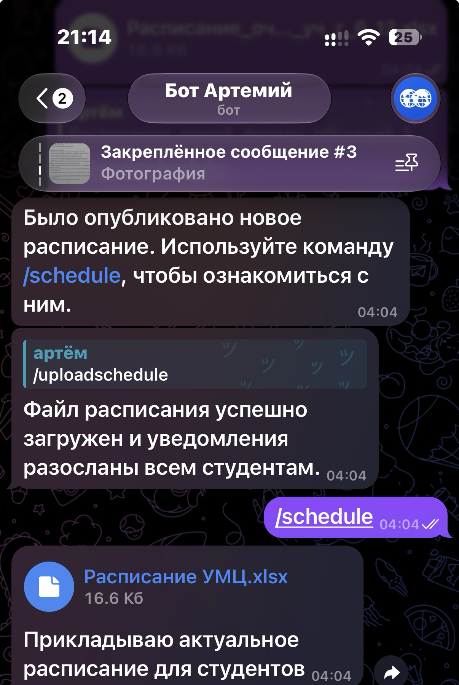
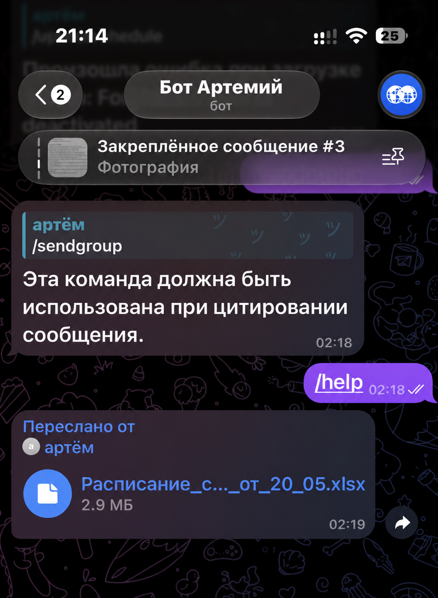
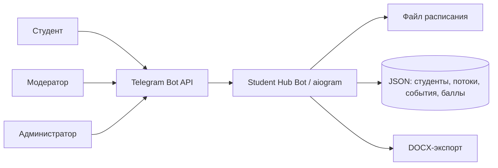

# Student Hub Bot

Telegram-прототип единого учебного пространства для студентов: расписание, учебные рассылки, мероприятия и управление группами прямо в мессенджере.

> Архивный pet-project 2024–2025 годов. Это очищенная портфолио-версия реально использовавшегося MVP, а не официальная интеграция с информационной системой вуза.

## Задача

Учебная информация обычно разбросана между чатами, файлами и разными сервисами. Идея Student Hub Bot — собрать повседневные сценарии в привычном для студентов Telegram-интерфейсе.

## Что реализовано в MVP

- загрузка и выдача актуального расписания;
- рассылка сообщений, файлов и конспектов всем студентам или одной группе;
- роли администратора и модератора группы;
- реестр студентов, смена группы и проверка доступности бота;
- создание мероприятий и экспорт списка участников в DOCX;
- пользовательские потоки с приглашениями, ролями и отдельными рассылками;
- публикация учебных заданий с ограничением числа откликов;
- прототип начисления учебных баллов;
- локальное JSON-хранилище для прототипирования.

Подсистемы заданий и баллов оставались экспериментальными: они демонстрируют логику MVP, но требуют дополнительной проверки перед реальным применением.

## Интерфейс прототипа

Исторические скриншоты показывают два рабочих сценария: публикацию актуального расписания и подготовку групповой рассылки. Публичные версии кадрированы так, чтобы в них не осталось ФИО студентов, Telegram ID и результатов обучения.

| Расписание | Групповая рассылка |
| --- | --- |
| Администратор загружает новый файл, после чего бот уведомляет студентов и выдаёт актуальную версию по команде `/schedule`. | Бот принимает сообщение или файл для отправки выбранной учебной группе. |
|  |  |

## Архитектура



## Стек

- Python 3.10–3.11
- aiogram 2.x
- python-docx
- python-dotenv

## Локальный запуск

```bash
python3.11 -m venv .venv
source .venv/bin/activate
pip install -r requirements.txt
cp .env.example .env
python src/bot.py
```

Перед запуском укажите в `.env` токен нового Telegram-бота и ID администратора. Для теста можно скопировать `data/students.example.json` в `data/students.json` и заменить условные ID.

Остальные демонстрационные хранилища создаются аналогично:

```bash
cp data/events.example.json data/events.json
cp data/mailing.example.json data/mailing.json
cp data/scores.example.json data/scores.json
cp data/streams.example.json data/streams.json
```

`COMMITTEE_CHAT_ID` нужен только для экспериментального сценария публикации заданий. Если оставить значение `0`, команда `/addwork` будет недоступна, а остальные функции продолжат работать.

## Основные команды

| Сценарий | Команды |
| --- | --- |
| Расписание | `/uploadschedule`, `/schedule` |
| Рассылки | `/sendall`, `/writeall`, `/sendgroup`, `/writegroup` |
| Студенты и доступ | `/addstudent`, `/deletestudent`, `/changegroup`, `/list`, `/listid`, `/checkaccess` |
| Мероприятия | `/createevent`, `/finishevent` |
| Учебные потоки | `/createstream`, `/addstreamstudent`, `/sendstream`, `/mystreams`, `/streamlist`, `/deletestream` |
| Задания и баллы | `/addwork`, `/addscore`, `/scorelist` |

## Безопасность и приватность

- В репозитории нет реальных токенов, Telegram ID, имён студентов, оценок или учебных файлов.
- `.env`, рабочие JSON-файлы и расписание исключены из Git.
- Даже для демонстрации лучше использовать отдельного тестового бота и только синтетические данные.
- Исходные рабочие выгрузки и альтернативные ранние версии бота намеренно не публикуются: они содержали персональные данные и дублирующийся экспериментальный код.

## Ограничения прототипа

- один процесс и файловое хранилище вместо базы данных;
- нет веб-интерфейса и интеграции с электронным журналом вуза;
- ролевая модель упрощена для MVP;
- нужны миграции, тесты, аудит доступов и мониторинг для production-использования.
- исторический стек `aiogram 2.x` требует Python 3.10 или 3.11; миграция на `aiogram 3.x` оставлена за рамками архивной версии.

## Чему научил проект

Проект помог пройти полный цикл прототипирования: от наблюдения за проблемой и проектирования ролей до Telegram Bot API, асинхронных рассылок, файлового хранения и экспорта документов.

---

Код опубликован как портфолио-архив. Перед реальным запуском потребуется техническая доработка.
