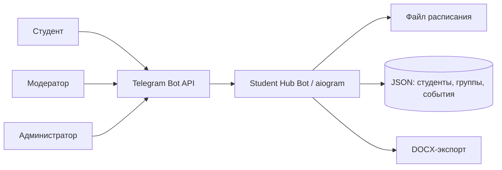

# Student Hub Bot

Telegram-прототип единого учебного пространства для студентов: расписание, учебные рассылки, мероприятия и управление группами прямо в мессенджере.

> Архивный pet-project 2025 года. Репозиторий показывает продуктовую идею и MVP, а не готовую официальную интеграцию с информационной системой вуза.

## Задача

Учебная информация обычно разбросана между чатами, файлами и разными сервисами. Идея Student Hub Bot — собрать повседневные сценарии в привычном для студентов Telegram-интерфейсе.

## Что реализовано в MVP

- загрузка и выдача актуального расписания;
- рассылка сообщений, файлов и конспектов всем студентам или одной группе;
- роли администратора и модератора группы;
- реестр студентов, смена группы и проверка доступности бота;
- создание мероприятий и экспорт списка участников в DOCX;
- локальное JSON-хранилище для прототипирования.

Подсистема оценок/баллов была заложена в прототипе, но не доведена до полного пользовательского сценария.

## Интерфейс прототипа

Исторические скриншоты показывают два рабочих сценария: публикацию актуального расписания и подготовку групповой рассылки. Публичные версии кадрированы так, чтобы в них не осталось ФИО студентов, Telegram ID и результатов обучения.

| Расписание | Групповая рассылка |
| --- | --- |
| Администратор загружает новый файл, после чего бот уведомляет студентов и выдаёт актуальную версию по команде `/schedule`. | Бот принимает сообщение или файл для отправки выбранной учебной группе. |
|  |  |

## Архитектура



## Стек

- Python 3.10+
- aiogram 2.x
- python-docx
- python-dotenv

## Локальный запуск

```bash
python -m venv .venv
source .venv/bin/activate
pip install -r requirements.txt
cp .env.example .env
python src/bot.py
```

Перед запуском укажите в `.env` токен нового Telegram-бота и ID администратора. Для теста можно скопировать `data/students.example.json` в `data/students.json` и заменить условные ID.

## Безопасность и приватность

- В репозитории нет реальных токенов, Telegram ID, имён студентов, оценок или учебных файлов.
- `.env`, рабочие JSON-файлы и расписание исключены из Git.
- Даже для демонстрации лучше использовать отдельного тестового бота и только синтетические данные.

## Ограничения прототипа

- один процесс и файловое хранилище вместо базы данных;
- нет веб-интерфейса и интеграции с электронным журналом вуза;
- ролевая модель упрощена для MVP;
- нужны миграции, тесты, аудит доступов и мониторинг для production-использования.

## Чему научил проект

Проект помог пройти полный цикл прототипирования: от наблюдения за проблемой и проектирования ролей до Telegram Bot API, асинхронных рассылок, файлового хранения и экспорта документов.

---

Код опубликован как портфолио-архив. Перед реальным запуском потребуется техническая доработка.
